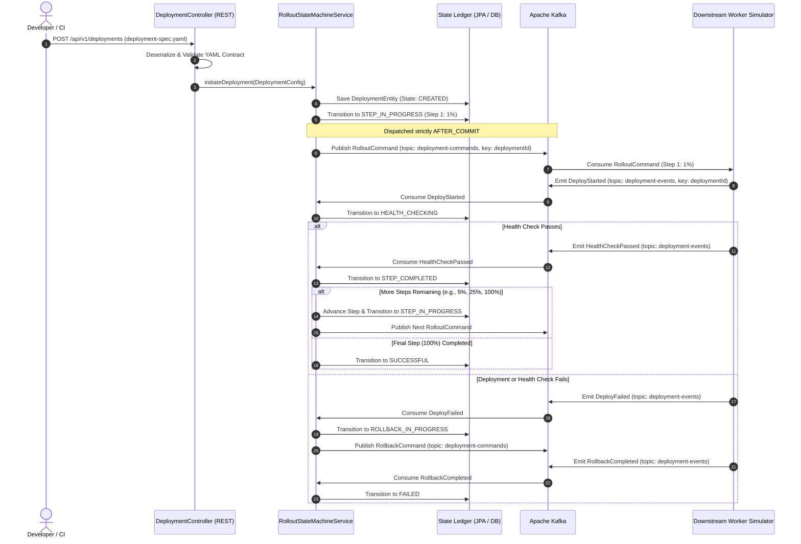
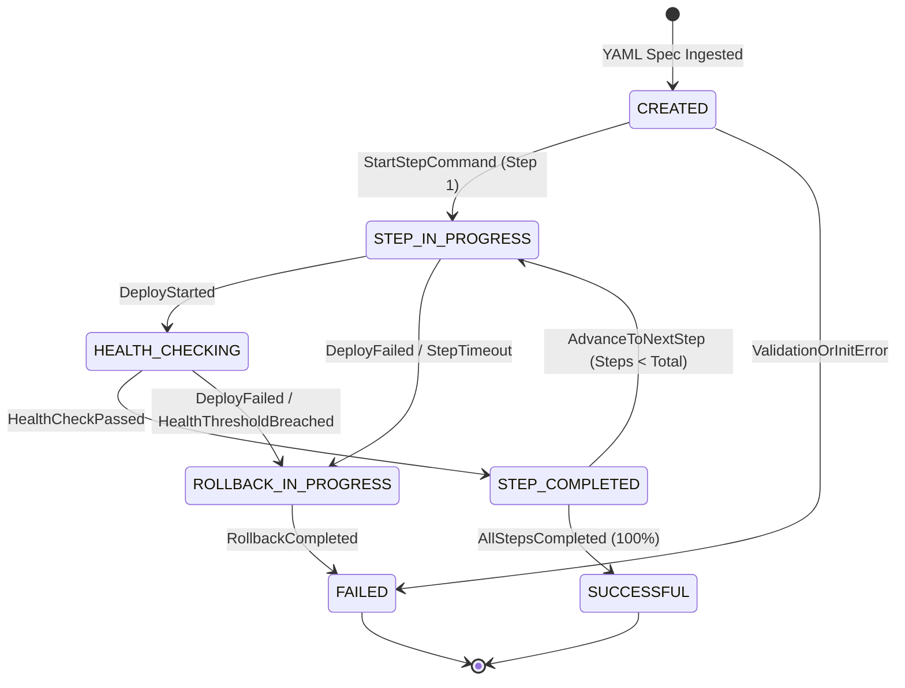

# System Architecture: Release Train Orchestrator

## 1. High-Level Overview

The **Release Train Orchestrator** is an event-driven Control Plane built with **Java 17**, **Spring Boot 4.1**, **Apache Kafka**, and **Spring Data JPA**. It automates progressive canary rollouts (e.g., `1% -> 5% -> 25% -> 100%`) across distributed microservices by parsing declarative YAML deployment specifications and reacting to asynchronous lifecycle events.

### Core Architectural Principles
- **Strict Ordering per Rollout:** All Kafka topics are partitioned by `deploymentId`, guaranteeing that events for a single release train are processed sequentially without race conditions.
- **Transactional State Persistence:** State machine transitions are committed to the relational ledger (PostgreSQL/H2) *before* dispatching downstream Kafka commands (`TransactionPhase.AFTER_COMMIT`).
- **Decoupled Execution:** The Orchestrator never makes synchronous HTTP calls to downstream services; it communicates strictly via Kafka topics (`deployment-commands` and `deployment-events`).

---

## 2. End-to-End Sequence Flow

This sequence diagram defines the complete lifecycle from developer YAML submission through progressive step completion and failure rollback.



## 3. Rollout State Machine

Every deployment follows a deterministic finite state machine persisted in the database. Invalid transitions (e.g., receiving `HealthCheckPassed` while already in `ROLLBACK_IN_PROGRESS`) must be rejected and logged as idempotent/stale events.



## 4. Kafka Topic & Event Contracts

All Kafka messages use JSON serialization with Spring `__TypeId__` headers disabled (`spring.json.add.type.headers=false`). Consumers bind explicitly to Java 17 `record` schemas.

| Topic Name | Partitions | Partition Key | Producer | Consumer | Purpose |
| :--- | :--- | :--- | :--- | :--- | :--- |
| `deployment-commands` | 3 | `deploymentId` | Orchestrator | Downstream Worker | Instructs services to apply a target percentage rollout or execute a rollback. |
| `deployment-events` | 3 | `deploymentId` | Downstream Worker | Orchestrator | Reports real-time execution and health telemetry back to the state machine. |
| `deployment-events-dlt` | 1 | `deploymentId` | Orchestrator | Ops / Alerting | Dead Letter Topic for malformed or unprocessable lifecycle events after retries. |

### Command Payload Schema (`deployment-commands`)
```json
{
  "commandId": "cmd-98a1b2c3",
  "deploymentId": "release-v2.4.0",
  "serviceName": "payment-gateway",
  "version": "2.4.0",
  "commandType": "EXECUTE_STEP",
  "stepNumber": 1,
  "targetPercentage": 1,
  "timestamp": "2026-11-13T07:45:00Z"
}
```
*(Valid `commandType` values: `EXECUTE_STEP`, `ROLLBACK`)*

### Event Payload Schema (`deployment-events`)
```json
{
  "eventId": "evt-77f8e9d0",
  "deploymentId": "release-v2.4.0",
  "serviceName": "payment-gateway",
  "stepNumber": 1,
  "eventType": "HealthCheckPassed",
  "details": "p99 latency 42ms, error rate 0.01%",
  "timestamp": "2026-11-13T07:45:30Z"
}
```
*(Valid `eventType` values: `DeployStarted`, `HealthCheckPassed`, `DeployFailed`, `RollbackCompleted`)*

---

## 5. REST API & YAML Configuration Contract

### Endpoint: `POST /api/v1/deployments`
- **Content-Type:** `application/x-yaml` or `text/yaml`
- **Response:** `202 Accepted` with JSON status body containing `deploymentId` and initial state.

### Sample `deployment-spec.yaml`
```yaml
deploymentId: "release-v2.4.0"
serviceName: "payment-gateway"
version: "2.4.0"
strategy:
  steps:
    - step: 1
      percentage: 1
      pauseDurationSeconds: 30
    - step: 2
      percentage: 5
      pauseDurationSeconds: 60
    - step: 3
      percentage: 25
      pauseDurationSeconds: 120
    - step: 4
      percentage: 100
      pauseDurationSeconds: 0
```

## 6. Package Organization (io.github.kapil1502.releasetrain)

The following directory structure represents the base package `io.github.kapil1502.releasetrain` for the Release Train Orchestrator. This structure maps directly inside your `src/main/java/` directory.

```text
io.github.kapil1502.releasetrain
├── ReleaseTrainApplication.java     <-- @SpringBootApplication entry point
├── config/                          # Kafka topic beans, Jackson YAMLMapper bean, JSON serde config
├── controller/                      # REST API endpoints (POST /api/v1/deployments, GET /{id}/status)
├── domain/                          # JPA @Entity classes (DeploymentEntity, StepAuditLogEntity)
├── dto/                             # Java 17 immutable records (DeploymentSpec, RolloutCommand, DeploymentEvent)
├── repository/                      # Spring Data JPA repositories
├── service/                         # Core state machine transition engine & YAML validator
└── messaging/                       # @KafkaListener consumers & AFTER_COMMIT command producers
```